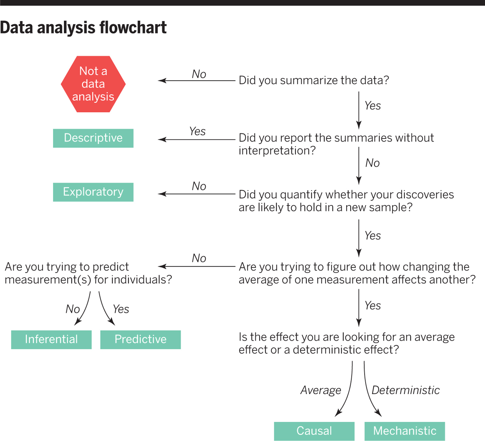
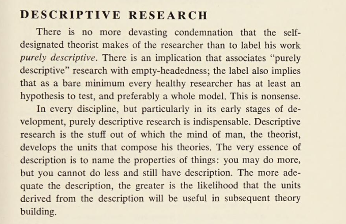
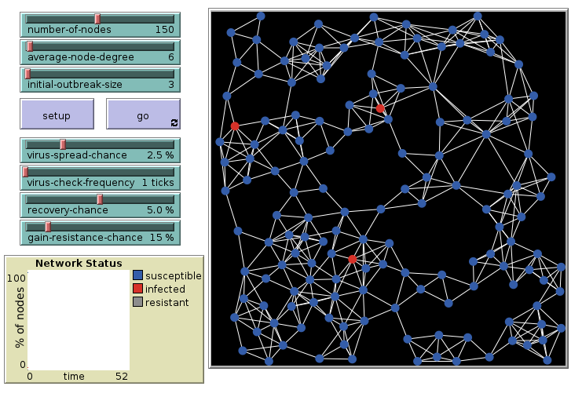
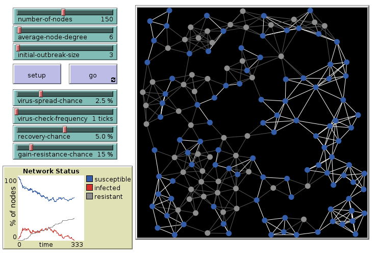
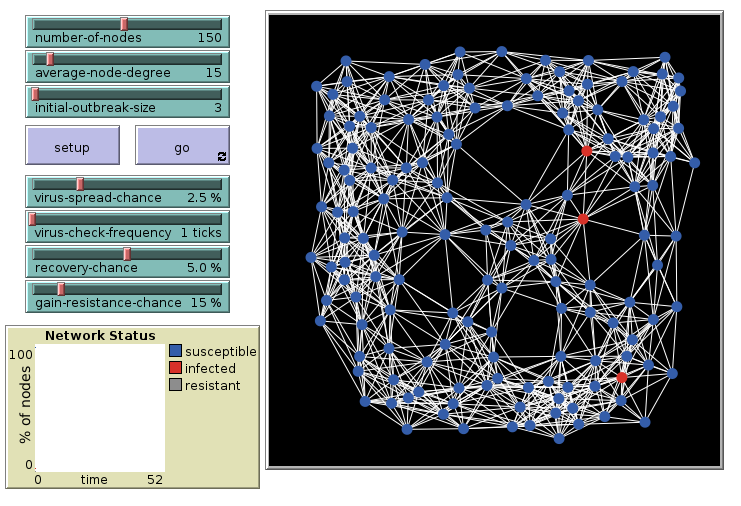
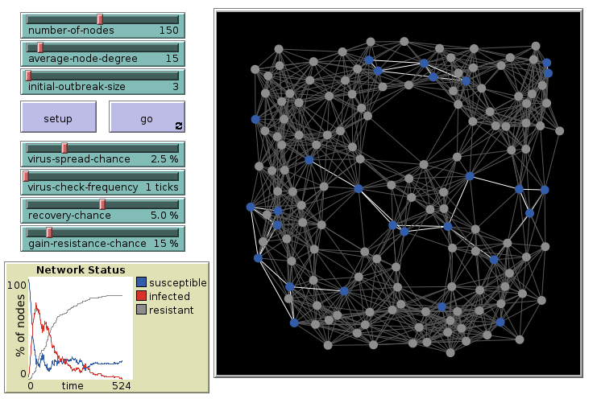

## Preliminaries

```{r}
#| echo: true

library(tidyverse)
library(palmerpenguins)
```


# Types of Data Science Questions {background-color="khaki"}

## Six types of questions {background-color="khaki" .smaller}

1.  **Descriptive:** summarize a characteristic of a set of data
2.  **Exploratory:** analyze to see if there are patterns, trends, or relationships between variables (hypothesis generating)
3.  **Inferential:** analyze patterns, trends, or relationships in representative data from a population
4.  **Predictive:** make predictions for individuals or groups of individuals
5.  **Causal:** whether changing one variable will change another variable, on average, in a population
6.  **Mechanistic:** explore "how" one factor (probably/most likely/potentially) changes another


:::{.aside}
Leek, Jeffery T., and Roger D. Peng. 2015. “What Is the Question?” Science 347 (6228): 1314–15. <https://doi.org/10.1126/science.aaa6146>.
:::


## Data Analysis Flowchart {background-color="khaki"}

{fig-align="center" height="550"}

## Example: NYC Flights  {background-color="khaki" .smaller}

::: {.incremental}
1. **Descriptive:** Examine the average flight delays for flights departing from New York City airports. 
2. **Exploratory:** Examine the relationship of flight delays with other variables, like the destination, the weather at departure, the departure the airline, the plane, ...
3.  **Inferential:** Examine if relationships between delays and other are likely to hold for *for all flights at large*.
4. **Predictive:** Examime whether flight delays of individual flights can be predicted days or hours ahead.
5. **Causal:** Examine whether changing a plane or the departure time will bring down the average delay. (Probably hard or impossible with the given data.)
6.  **Mechanistic:** Examine the exact reasons for the delay by following the chain of actions in scheduling departure, while flying, and scheduling the landing. (Information is not in the given data)
:::

## Example: COVID-19 and Vitamin D  {background-color="khaki" .smaller}

(For individual study)

1. **Descriptive:** the frequency of daily hospitalisations due to COVID-19 and the frequency of Vitamin D intake in a sample of people
2. **Exploratory:** examine the relationships between taking Vitamine D supplements and COVID-19 hospitalisations in a sample of people diagnosed with COVID-19
3.  **Inferential:** examine whether any relationship between taking Vitamin D supplements and COVID-19 hospitalisations found in the sample hold *for the population at large*
4. **Predictive:** examine what types of people and how many will take Vitamin D supplements next year
5. **Causal:** examine whether people with COVID-19 who were randomly assigned to take Vitamin D supplements or those who were not are hospitalised 
6.  **Mechanistic:** examine when and *how* increased vitamin D intake leads to a reduction in the number of viral illnesses


## When we do what {background-color="khaki" .smaller}


::: {.incremental}
1. **Descriptive** Beginning of EDA with Summary Statistic
2. **Exploratory** More question-driven EDA with specifc questions beyond summary statistics
3.  **Inferential** Estimating (linear) models, hypothesis tests, assess how plausible findings generalize to populations beyond what is in the data  
4. **Predictive** Machine learning, training models and assess the predicive performance using train-test splits of the data 
5. **Causal** Analyzing data from experiments (differences in randomized groups) or exploiting similar settings in observational data using hypothesis tests
6.  **Mechanistic** Develop mechanistic models as candidate explanation and validate or calibrate them with data
:::

::: aside
EDA = Explorartory Data Analysis
:::

<!-- ## Questions to questions  {background-color="khaki"}

-   Do you have appropriate data to answer your question?
-   Do you have information on confounding variables?
-   Was the data you're working with collected in a way that introduces bias?

:::{.aside}
**Example**  
I want to estimate the average number of children in households in Bremen.
I conduct a survey at an elementary school and ask pupils how many children, including themselves, live in their house.
Then, I take the average of the responses.

- Is this a biased or an unbiased estimate of the number of children in households in Bremen?
- If biased, will the value be an overestimate or underestimate?
::: -->


<!-- ## Context Information is important! {background-color="khaki" .smaller}

- Not all information is in the data!
- Potential confounding variables you infer from general knowledge
- Information about data collection you may receive from an accompanying report
- Information about computed variables you may need to look up in accompanying documentation
- Information about certain variables you may find in an accompanying **codebook**. For example the exact wording of questions in survey data.  -->


<!-- ## Descriptive Projects {background-color="khaki"}


::: {.columns}

::: {.column width='60%'}



:::

::: {.column}

- Descriptive research has value!
- New data collection 

:::

:::

::: aside
Dubin (1969). Theory Building - A Practical Guide to the Construction and Testing of Theoretical Models
:::
 -->


# Principal component analysis (PCA)

A typical part of Exploratory Data Analysis for the numerical variables.   
PCA gives an overview of the linear relations between all numerical variables.   
It extends the picture of the correlation matrix. 

## PCA Description {.smaller}

Principle component analysis 

- is a **dimensionality-reduction** technique. It can be used to reduce the number of variables.
- computes new variables which represent the data in a different way.
- transforms the data **linearly** to a new coordinate system where most of the variation in the data can be described with fewer variables than the original data.

**Today:** Quick walk through how to do, visualize and scutinize, and interpret a PCA. 


## Example: Numerical variables of penguins {.smaller}

```{r}
#| echo: true
peng <-
  penguins |>
  select(
    species,
    bill_length_mm,
    bill_depth_mm,
    flipper_length_mm,
    body_mass_g
  ) |>
  na.omit()
peng |> count(species)
```

In `peng` we have `r nrow(peng)` penguins and `r ncol(peng) - 1` numeric variables.


## Two Variables {.smaller}


Example for the new axes. 

```{r}
#| fig-height: 4
#| echo: true
#| code-fold: true
pca1 <- peng |>
  select(flipper_length_mm, bill_length_mm) |>
  prcomp(~., data = _, scale = FALSE)
pca_vec <- t(pca1$rotation) |> as_tibble() # Vectors with x = flipper_length, y = bill_length
ggplot(peng) +
  geom_point(aes(x = flipper_length_mm, y = bill_length_mm, color = species)) + # Draws the data point
  geom_segment(
    # Draws the arrows
    data = pca_vec, # Not using `peng` for this geom!
    aes(
      x = mean(peng$flipper_length_mm), # Use means from `peng` to anchor arrows!
      y = mean(peng$bill_length_mm), # Use means from `peng` to anchor arrows!
      xend = c(pca1$sdev) * flipper_length_mm + mean(peng$flipper_length_mm), # Use `pca1$sdev` to scale arrows
      yend = c(pca1$sdev) * bill_length_mm + mean(peng$bill_length_mm) # Use `pca1$sdev` to scale arrows
    ),
    arrow = arrow(length = unit(0.3, "cm"))
  ) +
  coord_fixed()
```

::: aside
The two arrows show the two eigenvectors of the covariance matrix of the two variables scaled by the square root of the corresponding eigenvalues, and shifted so their origins are at the means of both variables. 
:::


## Computation in R {.smaller}

Input: Data frame with only numerical variables. Use base R `prcomp` (don't use `princomp`). 

```{r}
#| echo: true
P <- peng |>
  select(flipper_length_mm, bill_length_mm) |>
  prcomp()
```

. . . 


:::: {.columns}

::: {.column width='50%'}
We get a list 

```{r}
#| echo: true
typeof(P)
class(P)
```

:::

::: {.column width='50%'}
The list items

```{r}
#| echo: true
names(P)
```

:::

::::

. . .

:::: {.columns}

::: {.column width='50%'}
The base output

```{r}
#| echo: true
P
```

:::

::: {.column width='50%'}
The summary output
```{r}
#| echo: true
summary(P)
```

:::

::::

💡 These outputs differ from standard list output because of the attribute `prcomp`.  


## The `prcomp` object {.smaller .scrollable}

Includes 4 different related entities.

:::: {.columns}

::: {.column width='50%'}
The **standard deviations** related to each principal component.   
```{r}
#| echo: true
P$sdev
```

The matrix of variable **loadings**. (It is also the matrix which rotates the original data vectors.)
```{r}
#| echo: true
P$rotation
```

:::

::: {.column width='50%'}
The means for each original variable. 
```{r}
#| echo: true
P$center
```
Note, there are also standard deviations of original variables in `$scale` when this is set to be used.

The centered (scaled, if set) and rotated data.
```{r}
#| echo: true
P$x
```

:::

::::

## PCA as Exploratory Data Analysis {.smaller}

Suppose we do a PCA with all `r nrow(peng)` penguins (rows) and all `r ncol(peng) - 1` numeric variables.

- *How long will the vector of standard deviations be?* [`r ncol(peng) - 1`]{.fragment}  
- *What dimensions will the rotation matrix have?* [`r ncol(peng) - 1` x `r ncol(peng) - 1`]{.fragment}  
- *What dimensions will the rotated data frame have?* [`r nrow(peng)` x `r ncol(peng) - 1`]{.fragment}

. . . 

When we do a PCA for exploration there are 3 things to look at: 

1. The data in PC coordinates - the centered (scaled, if set) and rotated data.  
2. The rotation matrix - the variable loadings.
3. The variance explained by each PC - based on the standard deviations. 

## All variables {.smaller}

Now, with `scale = TRUE` (recommended as default).   
Data will be centered and scaled (a.k.a. *standardized*) first. 

```{r}
#| echo: true
peng_PCA <- peng |> select(-species) |> prcomp(scale = TRUE)
peng_PCA
```


## Explore data in PC coordinates {.smaller}


:::: {.columns}

::: {.column width='35%'}
- Start plotting PC1 against PC2. By default these are the most important ones. Drill deeper later. 
- Append the original data. Here used to color by species. 
:::

::: {.column width='65%'}
```{r}
#| echo: true
#| fig-height: 5
plotdata <- peng_PCA$x |>
  as_tibble() |>
  bind_cols(peng)
plotdata |>
  ggplot(aes(PC1, PC2, color = species)) +
  geom_point() +
  coord_fixed() +
  theme_minimal(base_size = 20)
```

:::

::::


## Variable loadings {.smaller}

- The columns of the rotation matrix shows how the original variables *load* on the principle components. 
- We can interpret these loadings and give descriptive names to principal components. 
- For plotting we bring the rotation matrix to long format with `PC` and `value` column.

```{r}
#| echo: true
#| fig-height: 3
peng_PCA$rotation |>
  as_tibble(rownames = "variable") |>
  pivot_longer(starts_with("PC"), names_to = "PC", values_to = "value") |>
  ggplot(aes(value, variable)) +
  geom_col() +
  geom_vline(xintercept = 0, color = "blue") +
  facet_wrap(~PC, nrow = 1) +
  theme_minimal(base_size = 20)
```

## Variance explained {.smaller}

- Principle components are by default sorted by importance. 
- The squares of the standard deviation for each component gives its variances and **variances have to sum up to the sum of the variances** of the original variables. 
    - When original variables were standardized their original variances are all each one. Consequently, the variances of the principal components sum up to the number of original variables.
- A typical plot to visualize the importance of the components is to plot the percentage of the variance explained by each component.

```{r}
#| echo: true
#| output-location: column
tibble(PC = 1:4, sdev = peng_PCA$sdev) |>
  mutate(percent = sdev^2 / sum(sdev^2) * 100) |>
  ggplot(aes(PC, percent)) +
  geom_col() +
  theme_grey(base_size = 20)
```


## Interpretations (1) {.smaller}

```{r}
#| fig-height: 3
#| fig-width: 5
tibble(PC = 1:4, sdev = peng_PCA$sdev) |>
  mutate(percent = sdev^2 / sum(sdev^2) * 100, cum_percent = cumsum(percent)) |>
  ggplot(aes(PC, percent)) +
  geom_col() +
  geom_line(aes(y = cum_percent), color = "blue") +
  geom_point(aes(y = cum_percent), color = "blue") +
  scale_y_continuous(breaks = seq(0, 100, 20))
```

- The first component explains almost 70% of the variance.  
- The first two explain about 88% of the total variance. 


## Interpretations (2) {.smaller}

```{r}
#| fig-height: 3
peng_PCA$rotation |>
  as_tibble(rownames = "variable") |>
  pivot_longer(starts_with("PC"), names_to = "PC", values_to = "value") |>
  ggplot(aes(value, variable)) +
  geom_col() +
  geom_vline(xintercept = 0, color = "blue") +
  facet_wrap(~PC, nrow = 1)
```

1. To score high on PC1 a penguin needs to be generally large but with low bill depth.
2. Penguins scoring high on PC2 are penguins with generally small bills.  

## Interpretations (3) {.smaller}

```{r}
#| fig-height: 4

g1 <- plotdata |>
  ggplot(aes(PC1, PC2, color = species)) +
  geom_point() +
  coord_fixed()
g2 <- peng_PCA$rotation |>
  as_tibble(rownames = "variable") |>
  pivot_longer(starts_with("PC"), names_to = "PC", values_to = "value") |>
  filter(PC == "PC2" | PC == "PC1") |>
  ggplot(aes(value, variable)) +
  geom_col() +
  facet_wrap(~PC, nrow = 1)
library(patchwork)
g1 + g2
```

{height=120}
{height=120}
{height=120}


## Apply PCA {.smaller}

::: {.incremental}
- **Standardization** is the default preprocessing step. Benefit: Variables with numerically large values do not dominate. Draw back: The values of variables become less directly interpretable. 
- Further **preprocessing** steps can be **data transformation** for variables with skew distributions. Use log, square-root, or Box-Cox transformation. This may result in less outliers.
- PCA is a useful step of **exploratory data analysis** for a larger number of numerical variables. It shows the empirical *dimensionality* of the data and its linear structure.
- It is related to the correlation-matrix and can "summarize" its structure.
- Limitation: PCA is only sensitive for linear relationships (no U-shaped ones or the like)
- The principal components can be used **as predictors** in a model instead of the raw variables. 
:::

## Properties of PCA {.smaller}

::: {.incremental}
- The principal components (the columns of the rotation matrix) are maximally *uncorrelated* (actually they are even *orthogonal*).
- This also holds for the columns of the rotated data. 
- The total variances of all prinicipal components sum up to the number of variables (when variables are standardized)
- The PCA is unique. All principle components together are a complete representation of the data. (Unlike other technique of dimensionality reduction which may rely on starting values, random factors, or tuning parameters)
    - To be precise: It is unique modulo the sign of the PCs. When $x$ is a PC, then $-x$ is as well and can replace it.  
:::


## Relations of PCA {.smaller}

::: {.incremental}
- A technique similar in spirit is *factor analysis* (e.g. `factanal`). It is more theory based as it requires to specify to the theoriezed number of factors up front. 
- PCA is an example of the importance of linear algebra ("matrixology") in data science techniques. 
:::

. . .

:::: {.columns}

::: {.column width='50%'}
  - PCA is based on the **eigenvalue decomposition** of the covariance matrix (or correlation matrix in the standardized case) of the data.
:::

::: {.column width='50%'}
{ height=350 }  
<https://xkcd.com/1838/>
:::

::::


# Refresh Math: Exponentiation and Logarithm

## Rules for Exponentiation {background-color="aquamarine" .smaller}

:::{.columns}
:::{.column width="20%"}
$x^0$  

$0^x$  

$0^0$  

$(x\cdot y)^a$  

$x^{-a}$, $x^{-1}$  

$x^\frac{a}{b}$, $x^\frac{1}{2}$  

$(x^a)^b$  

::: 
:::{.column}
:::{.fragment fragment-index=1}
$x^0 = 1$
:::
:::{.fragment fragment-index=2}
$0^x = 0$ for $x\neq 0$
:::
:::{.fragment fragment-index=3}
$0^0 = 1$ (discontinuity in $0^x$)
:::
:::{.fragment fragment-index=4}
$(x\cdot y)^a = x^a\cdot x^b$  
:::
:::{.fragment fragment-index=5}
$x^{-a} = \frac{1}{x^a}$, $x^{-1} = \frac{1}{x}$  
:::
:::{.fragment fragment-index=6}
$x^\frac{a}{b} = \sqrt[b]{x^a} = (\sqrt[b]{x})^a,\ x^\frac{1}{2} = \sqrt{x}$  
:::
:::{.fragment fragment-index=7}
$(x^a)^b = x^{a\cdot b} = (x^b)^a \neq x^{a^b} = x^{(a^b)}$   
Example: $(4^3)^2 = 64^2 = 4096 \qquad 4^{3^2} = 4^9 = 262144$
:::
:::
:::


## More rules for exponentiation {.smaller background-color="aquamarine"}

:::{.columns}
:::{.column width="20%"}
$x^a\cdot x^b$
::: 
:::{.column width="79%"}
:::{.fragment}
$x^a\cdot x^b = x^{a+b}$  Multiplication of powers (with same base $x$) becomes addition of exponents.
:::
:::
:::

. . . 

:::{.columns}
:::{.column width="20%"}
$(x+y)^a$
::: 
:::{.column width="79%"}
:::{.fragment}
No "simple" form! For $a$ integer use *binomial expansion*.
$(x+y)^2 = x^2 + 2xy + y^2$  
$(x+y)^3 = x^3 + 3x^2y + 3xy^2 + y^3$  
$(x+y)^n = \sum_{k=0}^n {n \choose k} x^{n-k}y^k$
:::
:::
:::

. . . 

**Pascal's triangle**

:::{.columns}
:::{.column width="40%"}
{height=200} 
:::
:::{.column}
We meet it again in **Probability**:   
A row represents a *binomial distribution*   
Which tends to mimics the *normal distribution* more and more  
and is related to the *central limit theorem*
:::
:::


## Logarithms {.smaller background-color="aquamarine"}

**Definition:** A *logarithm* of $a$ for some base $b$ is the value of the exponent which brings $b$ to $a$: 
$\log_b(a) = x$ means that $b^x =a$

**Most common:**

- $\log_{10}$ useful for plotting data in logarithmic scales because the numbers can be interpreted easiest (number of decimals of the original values)
- $\log_{e}$ *natural logarithm* (also $\log$ or $\ln$) useful in calculus and statistics because of nice mathematical properties

. . .

:::{.columns}
:::{.column width="30%"}
$\log_{10}(100) =$
::: 
:::{.column}
:::{.fragment}
$2$
:::
:::
:::

. . .

:::{.columns}
:::{.column width="30%"}
$\log_{10}(1) =$
::: 
:::{.column}
:::{.fragment}
$0$
:::
:::
:::

. . .

:::{.columns}
:::{.column width="30%"}
$\log_{10}(6590) =$
::: 
:::{.column}
:::{.fragment}
$3.818885$
:::
:::
:::

. . .

:::{.columns}
:::{.column width="30%"}
$\log_{10}(0.02) =$
::: 
:::{.column}
:::{.fragment}
$-1.69897$
:::
:::
:::


## Rules for logarithms {.smaller background-color="aquamarine"}

Usually only one base is used in the same context, because changing base is easy:

$\log_c(x) = \frac{\log_b(x)}{\log_b(c)} = \frac{\log(x)}{\log(c)}$


:::{.columns}
:::{.column width="20%"}
$\log(x\cdot y)$
::: 
:::{.column width="79%"}
:::{.fragment}
$= \log(x) + \log(y)$ Multiplication $\to$ addition.
:::
:::
:::

. . .

:::{.columns}
:::{.column width="20%"}
$\log(x^y)$
::: 
:::{.column width="75%"}
:::{.fragment}
$= y\cdot\log(x)$
:::
:::


:::
:::{.columns}
:::{.column width="20%"}
$\log(x+y)$
::: 
:::{.column width="75%"}
:::{.fragment}
complicated!
:::
:::
:::

. . . 

Also changing bases for powers is easy: $x^y = (e^{\log(x)})^y = e^{y\cdot\log(x)}$


# Epidemic Modeling

- Example of a **model** for the **data generating process**
- We treat *mechanistic questions* here


## SIR model  {.smaller  background-color="khaki"}

- Assume a population of $N$ individuals.  
- Individuals can have different states, e.g.: **S**usceptible, **I**nfectious, **R**ecovered, ...
- The population divides into **compartments** of **S**, **I**, and **R** individuals. 

Dynamics with transition rates between compartments:

```{mermaid}
graph LR
    S["S(t)<br/>Susceptible"]
    I["I(t)<br/>Infectious"]
    R["R(t)<br/>Recovered"]
    
    S -->|βSI/N| I
    I -->|γI| R
    R -->|σR| S
    
    style S fill:#e1f5ff
    style I fill:#ffebee
    style R fill:#e8f5e9
```

- **β** transmission rate (contacts per unit time × probability of infection)
- **γ** recovery rate 
- **σ** waning immunity rate

## Agent-based Simulation {.smaller  background-color="khaki"}

**Agent-based model**: Individual agents are simulated and interact with each other.  
Explore and analyze with **computer simulations**.

A tool: **NetLogo** <https://ccl.northwestern.edu/netlogo/>


We look at the model **"Virus on a Network"** from the model library.

Direct Link to [Virus on a Network in NetLogoWeb](https://www.netlogoweb.org/launch#https://www.netlogoweb.org/assets/modelslib/Sample%20Models/Networks/Virus%20on%20a%20Network.nlogo)

## Virus on a Network: 6 links, initial {.smaller  background-color="khaki"}

Agents connected in a **network** with on average 6 links per agent. 3 are infected initially.




## Virus on a Network: 6 links, final {.smaller  background-color="khaki"}

The outbreak dies out after some time.




## Virus on a Network: 15 links, initial {.smaller  background-color="khaki"}

Repeat the simulation with 15 links per agent. 3 are infected initially.



## Virus on a Network: 15 links, final {.smaller  background-color="khaki"}

The outbreak had infected most agents.




## Simlify: SI model {.smaller  background-color="khaki"}

- People who are susceptible can become infected through contact with infectious
- People who are infectious stay infectious 

The parameter $\beta$ is the average number of contacts per unit time multiplied with the probability that an infection happens during such a contact. 

```{mermaid}
graph LR
    S["S(t)<br/>Susceptible"]
    I["I(t)<br/>Infectious"]
    
    S -->|βSI/N| I
    
    style S fill:#e1f5ff
    style I fill:#ffebee
```

. . . 

3 ways to analyze: 

- Agent-based **Simulation**
- **Analytical solution** of differential equation
- **Numerical intergration** of differential equation


## SI-model: Simulation in R {.smaller background-color="khaki"}

- We produce a vector of length $N$ with entries representing the state of each individual as `"S"` or `"I"`. 
- We model the random infection process in each step of unit time

**Setup**

Parameters: $N=150, \beta=0.3$, a function to produce randomly infect individuals

```{r}
#| echo: true
#| output-location: column
N <- 150
beta <- 0.3
randomly_infect <- function(N, prob) {
  runif(N) < prob
  # Gives a logical vector of length N
  # where TRUE appears with probability beta
}
# Test
randomly_infect(N, beta) |> head(50) # First 50
```

```{r}
#| echo: true
#| output-location: column
init <- rep("S", N) # All susceptible
init[1] <- "I" # Infect one individual
init |> head(50) # First 50
``` 


## SI-model: Simulation in R {.smaller background-color="khaki"}

Iteration over 75 time steps.

```{r}
#| echo: true
#| output-location: column
tmax <- 75
sim_run <- list(init) # list with one element
# This list will collect the states of
# all individuals over tmax time steps
for (i in 2:tmax) {
  # Every agents has a contact with a random other
  contacts <- sample(sim_run[[i - 1]], size = N)
  sim_run[[i]] <- if_else(
    # vectorised ifelse
    # conditions vector: contact is infected
    # and a random infection happens
    contacts == "I" & randomly_infect(N, beta),
    true = "I",
    false = sim_run[[i - 1]]
  ) # otherwise state stays the same
}
sim_output <- tibble(
  # create tibble for ggplot
  # Compute a vector with length tmax
  # with the count of "I" in sim_run list
  t = 0:(tmax - 1), # times steps
  # count of infected and output a vector
  infected = sim_run |> map_dbl(\(x) sum(x == "I"))
)
sim_output |>
  ggplot(aes(t, infected)) +
  geom_line() +
  theme_minimal(base_size = 20)
```

## SI-model: Simulation in R {.smaller background-color="khaki"}

Run with $N = 10000$

```{r}
#| echo: true
#| output-location: column
N <- 10000
init <- rep("S", N) # All susceptible
init[1] <- "I" # Infect one individual
tmax <- 75
sim_run <- list(init) # list with one element
# This list will collect the states of
# all individuals over tmax time steps
for (i in 2:tmax) {
  # Every agents has a contact with a random other
  contacts <- sample(sim_run[[i - 1]], size = N)
  sim_run[[i]] <- if_else(
    # vectorised ifelse
    # conditions vector: contact is infected
    # and a random infection happens
    contacts == "I" & randomly_infect(N, beta),
    true = "I",
    false = sim_run[[i - 1]]
  ) # otherwise state stays the same
}
sim_output <- tibble(
  # create tibble for ggplot
  # Compute a vector with length tmax
  # with the count of "I" in sim_run list
  t = 0:(tmax - 1), # times steps
  # count of infected, notice map_dbl
  infected = map_dbl(sim_run, \(x) sum(x == "I"))
)
sim_output |>
  ggplot(aes(t, infected)) +
  geom_line() +
  theme_minimal(base_size = 20)
```


## New programming concepts {.smaller}

From base R:

`runif` random numbers from uniform distribution  
`sample` random sampling from a vector  
`for` loop over commands with index (`i`) taking values of a vector (`2:tmax`) one by one

From tidyverse `dplyr`

`if_else` vectorized version of conditional statements


# Calculus {background-color="aquamarine" }

The mathematics of 

- the **change** and 
- the **accumulation** 

of quantities. 

Another way to analyze the SI-model.

## Motivation:  SI model with <br> population compartments {background-color="khaki"}

Two compartments:   
$S(t)$ is the number of susceptible people at time $t$.  
$I(t)$ is the number of infected people at time $t$.  

It always holds $S(t) + I(t) = N$. (The total population is constant.)

## How many infections per time? {.smaller background-color="khaki"}

The **change** of the number of infectious

$$\frac{dI}{dt} = \underbrace{\beta}_\text{infection prob.} \cdot \underbrace{\frac{S}{N}}_\text{frac. of $S$ still there} \cdot \underbrace{\frac{I}{N}}_\text{frac. $I$ to meet} \cdot N = \frac{\beta\cdot S\cdot I}{N}$$

where $dI$ is the *change* of $I$ (the newly infected here) and $dt$ the time interval.  
[**COVID19-Data comparison:** When $dt$ is a day, then $\frac{dI}{dt}$ are the daily new cases. ]{.text-green} 

. . . 

**Interpretation:** The newly infected are from the fraction of susceptible *times* the probability that they meet an infected *times* the infection probability *times* the total number of individuals. [Same logic as our Simulation in R!]{.text-red}

. . . 

Using $S = N - I$ we rewrite

$$\frac{dI}{dt} = \frac{\beta (N-I)I}{N}$$


## Ordinary differential equation {background-color="aquamarine"}

We interpret $I(t)$ as a function of time which gives us the number of infectious at each point in time. The change function is now

$$\frac{dI(t)}{dt} = \frac{\beta (N-I(t))I(t)}{N}$$

and $\frac{dI(t)}{dt}$ is also called the [**derivative**]{.text-red} of $I(t)$. 

## Derivatives {.smaller  background-color="aquamarine"}

::: {.columns}

::: {.column width='70%'}
- The *derivative* is a function with the same domain. 
- Measures the sensitivity to change of the function output when the input changes (just a bit)
- Example from **physics**:   
  The derivative of the *position* of a moving object is *velocity*.  
  The derivative of its *velocity* is its *acceleration.* 
- Graphically: The derivative is the *slope* of a *tangent line* of the graph of a function. 
:::

::: {.column width='30%' .fragment}

:::

:::

## Refresh Math: Differentiation {.smaller  background-color="aquamarine"}
 
**Differentiation** is the process to compute the derivative. For numbers $a$ and $b$ and other functions $g$ and $h$, rules of differentiation are

:::{.columns}
:::{.column width="30%"}
Function $f(x)$
::: 
:::{.column width='70%'}
Its derivative $\frac{df(x)}{dx}$ or  $\frac{d}{dx}f(x)$ or $f'(x)$
:::
:::

:::{.columns}
:::{.column width="30%"}
$a\cdot x$

$b$

$x^2,\ x^{-1} = \frac{1}{x},\ x^k$

$g(x) + h(x)$

$g(x)\cdot h(x)$

$g(h(x))$

$e^x,\ 10^x  = e^{\log(10)x}$

$\log(x)$
::: 
:::{.column width='70%'}
:::{.fragment fragment-index=1}
$a$
:::
:::{.fragment fragment-index=2}
$0$
:::
:::{.fragment fragment-index=3}
$2\cdot x,\ -x^{-2} = -\frac{1}{x^2},\ k\cdot x^{k-1}$
:::
:::{.fragment fragment-index=4}
$g'(x) + h'(x)$
:::
:::{.fragment fragment-index=5}
$g'(x)\cdot h(x) + g(x)\cdot h'(x)$ (product rule)
:::
:::{.fragment fragment-index=6}
$g'(h(x))\cdot h'(x)$ (chain rule)
:::
:::{.fragment fragment-index=7}
$e^x,\ 10^x = \log(10)\cdot10^x$
:::
:::{.fragment fragment-index=}
$\frac{1}{x}$ (A surprising relation to me at least)
:::
:::
:::

## Differential equation {.smaller  background-color="aquamarine"}

In a differential equation the *unknown* is a function!

We are looking for a function which derivative is a function of the function itself. 

**Example: SI-model**

$$\frac{dI(t)}{dt} = \frac{\beta (N-I(t))I(t)}{N}$$

Which function $I(t)$ fulfills this equation?

The **analytical solution**^[Can you check that this is correct? Compute $I'(t)$ ($=\frac{dI(t)}{dt}$) and check if $I'(t) = \frac{\beta (N-I(t))I(t)}{N}$. It is a bit of work, but try it! Let me know, if you want a solution.] 

$I(t) = \frac{N}{1 + (\frac{N}{I(0)} - 1)e^{-\beta t}}$

Which is called the *logistic equation*. 
Note, we need to specify the initial number of infectious individuals $I(0)$. 

## SI-model: Logistic Equation {.smaller  background-color="khaki"}

$I(t) = \frac{N}{1 + (\frac{N}{I(0)} - 1)e^{-\beta t}}$

Plot the equation for $N = 10000$, $I_0 = 1$, and $\beta = 0.3$

```{r}
#| echo: true
#| fig-height: 3
N <- 10000
I0 <- 1
beta <- 0.3
ggplot() +
  geom_function(
    fun = function(t) N / (1 + (N / I0 - 1) * exp(-beta * t)),
    color = "blue"
  ) +
  xlim(c(0, 75))
```

## SI-model: Numerical integration {.smaller background-color="khaki"}

Another way of solution is **numerical integration**, e.g. using *Euler's method*. 

We compute the solution step-by-step using increments of, e.g. $dt = 1$.

```{r}
#| echo: true
#| output-location: column
#| style: "max-height: 400px; overflow-y: auto;"
N <- 10000
I0 <- 1
dI <- function(I, N, b) b * I * (N - I) / N
beta <- 0.3
dt <- 1 # time increment,
# supposed to be infinitesimally small
tmax <- 75
t <- seq(0, tmax, dt)
# this is the vector of timesteps
It <- I0 # this will become the vector
# of the number infected I(t) over time
for (i in 2:length(t)) {
  # We iterate over the vector of time steps
  # and incrementally compute It
  It[i] <- It[i - 1] + dt * dI(It[i - 1], N, beta)
  # This is called Euler's method
}
tibble(t, It) |>
  ggplot(aes(t, It)) +
  geom_line(color = "red") +
  geom_function(
    fun = function(t) N / (1 + (N / I0 - 1) * exp(-beta * t)),
    color = "blue"
  ) +
  # In blue: Analytical solution for comparison
  theme_minimal(base_size = 20)
```

Why do the graphs deviate? [The step size $dt$ must be "infinitely" small]{.fragment}

## Numerical integration with smaller $dt$ {.smaller background-color="khaki"}

We compute the solution step-by-step using small increments of, e.g. $dt = 0.05$.

```{r}
#| echo: true
#| output-location: column
N <- 10000
I0 <- 1
dI <- function(I, N, b) b * I * (N - I) / N
beta <- 0.3
dt <- 0.05 # time increment,
# supposed to be infinitesimally small
tmax <- 75
t <- seq(0, tmax, dt)
# this is the vector of timesteps
It <- I0 # this will become the vector
# of the number infected I(t) over time
for (i in 2:length(t)) {
  # We iterate over the vector of time steps
  # and incrementally compute It
  It[i] <- It[i - 1] + dt * dI(It[i - 1], N, beta)
  # This is called Euler's method
}
tibble(t, It) |>
  ggplot(aes(t, It)) +
  geom_line(color = "red") +
  geom_function(
    fun = function(t) N / (1 + (N / I0 - 1) * exp(-beta * t)),
    color = "blue"
  ) +
  # In blue: Analytical solution for comparison
  theme_minimal(base_size = 20)
```


## Mechanistic model {.smaller background-color="khaki"}

The SI model is a potential answer to the **mechanistic question**:    
*How do epidemics spread?*

We treated 3 different ways to explore the model:

. . . 

- *Agent-based simulation*
  - We model every individual explicitly
  - Simulation involve random numbers! So simulation runs can be different!

. . .

- *Numerical integration* of differential equation
  - Needs a more abstract concept of *compartments*

. . . 

- *Analytical solutions* of differential equation
  - often not possible (therefore numerical integration is common)


## Differentiation with data {.smaller}

[**We can do calculus operations with data!**]{style='color:red;'}

In empirical data we can compute the increase in a vector with the function `diff`:

```{r}
#| echo: true
x <- c(1, 2, 4, 5, 5, 3, 0)
diff(x)
```

. . . 

More convenient in a data frame is to use `x - lag(x)` because the vector has the same length.

```{r}
#| echo: true
x - lag(x)
```


## The diff of our simulation output {.smaller}

```{r}
#| echo: true
#| fig-height: 2
g1 <- sim_output |> ggplot(aes(x = t)) + geom_line(aes(y = infected))
g1
g2 <- sim_output |>
  mutate(derivative_infected = infected - lag(infected)) |>
  ggplot(aes(x = t)) +
  geom_line(aes(y = derivative_infected))
g2
```

## 2nd derivative: Change of change 

```{r}
#| echo: true
#| fig-height: 2
g3 <- sim_output |>
  mutate(
    derivative_infected = infected - lag(infected),
    derivative2_infected = derivative_infected - lag(derivative_infected)
  ) |>
  ggplot(aes(x = t)) +
  geom_line(aes(y = derivative2_infected))
g3
```

In empirical data: Derivatives of higher order tend to show fluctuation


## Interpretation in SI-model {.smaller  background-color="khaki"}

```{r}
#| fig-height: 3
library(patchwork)
g1 + g2 + g3
```

- $I(t)$ total number of infected
- $I'(t)$ number of new cases per day (time step)
- $I''(t)$ how the number of new cases has changes compared to yesterday
  - [2nd derivatives are a good early indicator for the end of a wave.]{.text-red}

## Integration {.smaller background-color="aquamarine"}

The **integral** of the daily new cases from the beginning to day $s$ is $\int_{-\infty}^s f(t)dt$ and represents the total cases at day $s$. 

- The integral of a function $f$ up to time $s$ is also called the **anti-derivative** $F(s) = \int_{-\infty}^s f(t)dt$.
    - The symbol $\int$ comes from an S and means "sum".
- Compute the anti-derivative of data vector with `cumsum`.

```{r}
#| echo: true
x <- c(1, 2, 4, 5, 5, 3, 0)
cumsum(x)
```

- Empirically: Derivatives tend to become noisy, while integrals tend to become smooth.   


## Fundamental theorem of calculus {.smaller background-color="aquamarine"}

[**The integral of the derivative is the function itself.**](.text-red)


This shows the idea:
```{r}
#| echo: true
f <- c(1, 2, 4, 5, 5, 3, 0)
antiderivative <- cumsum(f)
antiderivative
diff(c(0, antiderivative)) # We have to put 0 before to regain the full vector
derivative <- diff(f)
derivative
cumsum(c(1, derivative))
# We have to put in the first value (here 1)
# manually because it was lost during the diff
```

## Calculus in Data Science


::: {.incremental}
- Calculus-thinking using derivatives is a powerful tool to analyze time series
- You can practically implement it! No deep knowledge needed to get started. 
- Calculus-thinking is behind many procedures of *mathematical optimization*, most notably **Gradient Descent**  
  Story: 
    - The **gradient** is a vector-valued function. It is based on a function describing a landscape over a highdimensional space. Each entry of the gradient is the **derivative** of that function in one dimension of the high-dimensional space.   
    - The gradient points to the direction where the landscape goes steepest up (and steepest down in the opposite direction). The idea of gradient descent is to follow this direction to reach the argmaximum (or argminimum) fast and efficient.
    - Gradient-based optimization powers most of modern deep learning, and therefore most of today’s AI training. 
:::