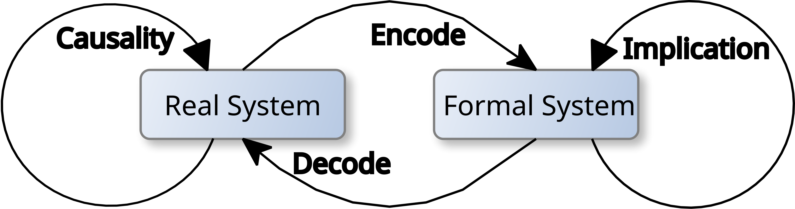
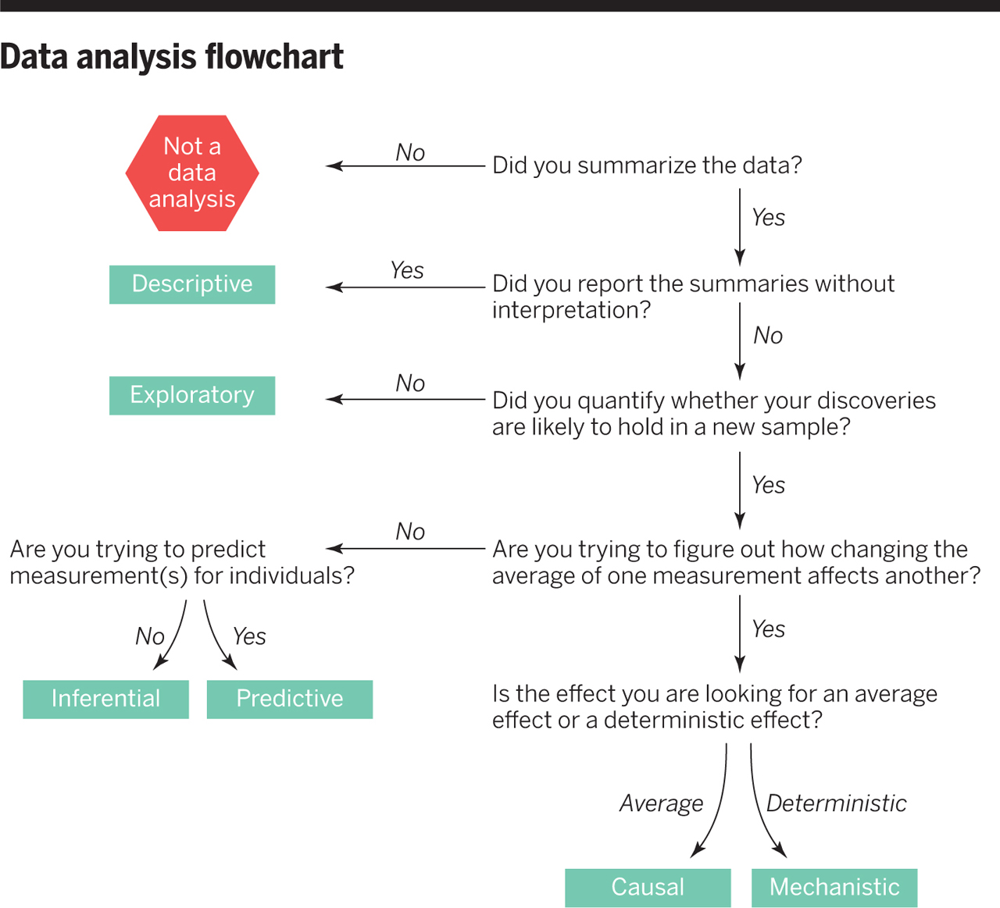
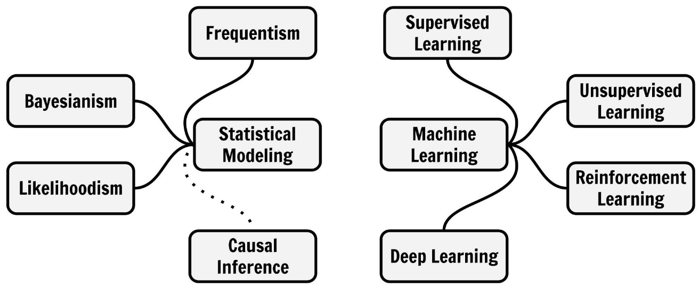
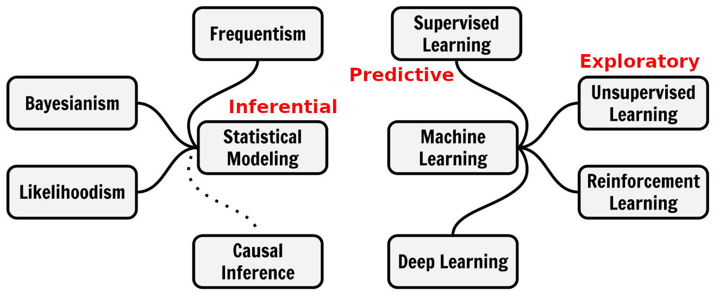

## Preliminaries

```{r}
#| echo: true
library(tidyverse)
library(tidymodels)
library(palmerpenguins)
```


# Models in Science

## What is a model? {.smaller background-color="khaki"}

- A model is an informative representation of an object, person or system. 

{height=300}
{height=300}
{height=300} 

. . .

- A model is a [**simplified**]{style='color:blue;'} representation of the real world focusing on the essential parts for its [**purpose**]{style='color:blue;'}.

::: aside
Source: <https://en.wikipedia.org/wiki/Model>
:::

## Scientific Modeling {.smaller background-color="khaki"}

:::: {.columns}

::: {.column width='50%'}
**Scientific modeling** is an activity that produces models representing empirical objects, phenomena, and physical processes, to make a particular part or feature of the world easier to 

::: {.incremental}
- understand, 
- define, 
- quantify, 
- visualize, or 
- simulate.
:::
:::

::: {.column width='50%'}




::: {.fragment}
#### Famous "wisdom" 

> [All models are wrong, but some are useful.](https://en.wikipedia.org/wiki/All_models_are_wrong)
:::

:::

::::

::: aside
Source: <https://en.wikipedia.org/wiki/Scientific_modelling>
:::


## Model Purposes and Data Analysis {.smaller background-color="khaki"}

:::: {.columns}

::: {.column width='60%'}

::: {.incremental}
- **Agent-based models** and **differential equations**
    - are used to **explain** the **dynamics** of one or more variables (typically) over time. They are used to answer [*mechanistic questions*]{style='color:blue;'}.
- [**Variable-based models**]{style='color:blue;'} 
    - are used to specify relations between variables
    - to **explain** relations and make **predictions**.
    - Used to answer [*inferential*]{style='color:blue;'} and [*predictive questions*]{style='color:blue;'}.   
    - With experimental and theoretical effort also for [*causal questions*]{style='color:blue;'}.
:::

:::

::: {.column width='40%'}

:::

::::

. . . 

The most basic variable-based model is the [**linear model**]{style='color:blue;'}.


## Models to Learn from Data {.smaller background-color="khaki"}

In much of the following we use a *narrower* definition of **model**:

A **mathematical model** that consists of **variables** and **functions**. 

. . . 

:::: {.columns}

::: {.column width='50%'}
Different names for [**variables**]{style='color:blue;'}: 

- random variables
- covariates
- predictors
- latent variables
- features
- targets
- outcomes

These names are inspired from different **theoretical** or **practical** purposes. 
:::

::: {.column width='50%' .fragment}
[**Functions**]{style='color:blue;'} relate variables to each other

- In a linear model we model one variable as a weighted sum of the other variables

::: {.fragment}
Once variables and functions are specified, modelers use [**Data**]{style='color:blue;'} **to find the *best*** function. Different names of

- estimation
- training
- fitting
- learning
:::

:::


::::


## Modeling Mindsets {.smaller background-color="khaki"}

For **Models to Learn from Data** there are many different [**Modeling Mindsets**]{style='color:blue;'}



::: aside
Molnar, C. (2022). [Modeling mindsets: The many cultures of learning from data.](https://books.google.de/books?id=qV-DzwEACAAJ) Christoph Molnar c/o Mucbook Clubhouse. 
:::


## Modeling Mindsets {.smaller background-color="khaki"}

Even within the setup of *Models to Learn from Data* there are many different [**Modeling Mindsets**]{style='color:blue;'}



::: aside
Molnar, C. (2022). [Modeling mindsets: The many cultures of learning from data.](https://books.google.de/books?id=qV-DzwEACAAJ) Christoph Molnar c/o Mucbook Clubhouse. 
:::


# Linear Model
The first work-horse model in data science


## Hello again penguins! {.scrollable .smaller}

We use the dataset [Palmer Penguins](https://allisonhorst.github.io/palmerpenguins/)

Chinstrap, Gentoo, and Adélie Penguins

{height=200}
{height=200}
{height=200}


```{r}
penguins
```

## Body mass in grams

```{r}
#| echo: true

penguins |>
  ggplot(aes(body_mass_g)) +
  geom_histogram()
```

## Flipper length in millimeters

```{r}
#| echo: true
penguins |>
  ggplot(aes(flipper_length_mm)) +
  geom_histogram()
```

## Model: Linear relation of variables {.smaller background-color="aquamarine"}

A **line** is a shift-scale transformation of the identity function usually written in the form 

$$f(x) = a\cdot x + b$$

where [$a$ is the *slope*]{style="color:red;"}, [$b$ is the *intercept*]{style="color:blue;"}.^[This is a scale and a shift in the $y$ direction. Note: For lines there is always an analog transformations on the $x$ direction.]

```{r}
#| echo: true
#| output-location: column
a <- 0.5
b <- 1
func <- function(x) a * x + b
ggplot() +
  geom_function(fun = func, size = 2) +
  # Set axis limits and make axis equal
  xlim(c(-0.5, 2)) +
  ylim(c(0, 2)) +
  coord_fixed() +
  geom_line(
    # intercept line:
    data = tibble(x = c(0, 0), y = c(0, 1)),
    mapping = aes(x, y),
    color = "blue",
    size = 2
  ) +
  geom_line(
    # slope:
    data = tibble(x = c(1.5, 1.5), y = c(1.25, 1.75)),
    mapping = aes(x, y),
    color = "red",
    size = 2
  ) +
  geom_line(
    # x-interval of length one:
    data = tibble(x = c(0.5, 1.5), y = c(1.25, 1.25)),
    mapping = aes(x, y),
    color = "gray"
  ) +
  theme_classic(base_size = 24)
```

## Penguins: Linear model {.smaller}

**Flipper length** as a function of **body mass**.

```{r}
#| echo: true
#| output-location: column
#| code-fold: false
#| fig-height: 9

penguins |>
  ggplot(aes(x = body_mass_g, y = flipper_length_mm)) +
  geom_point() +
  geom_smooth(method = "lm", se = FALSE) +
  theme_classic(base_size = 24)
```

## Penguins: A smooth curve {.smaller}

**Flipper length** as a function of **body mass** with `loess`^[loess = locally estimated scatterplot smoothing] smoothing. 

```{r}
#| echo: true
#| output-location: column
#| code-fold: false
#| fig-height: 7
penguins |>
  ggplot(aes(x = body_mass_g, y = flipper_length_mm)) +
  geom_point() +
  geom_smooth(method = "loess") +
  theme_classic(base_size = 24)
```

This function is part of a more *data-driven* and less *theory-driven* model. Why?    
[We don't have a simple mathematical form of the function.]{.fragment}

## Terminology variable-based models {.smaller background-color="khaki"}

::: {.incremental}
- **Response variable:**^[Also **dependent variable** in statistics and empirical social sciences.] Variable whose behavior or variation you are trying to understand, on the y-axis
- **Explanatory variable(s):**^[Also **independent variable(s)** in statistics and empirical social sciences.] Other variable(s) that you want to use to explain the variation in the response, on the x-axis
- **Predicted value:** Output of the model function. 
  - The model function gives the **(expected) average value** of the response variable conditioning on the explanatory variables
  - **Residual(s):** A measure of how far away a case is from its predicted value (based on the particular model)   
    Residual = Observed value minus Predicted value  
    The residual tells how far above/below the expected value each case is
:::

## More explanatory variables {.smaller}

How does the relation between flipper length and body mass change with different species?

```{r}
#| echo: true
#| output-location: column
#| code-fold: false
#| fig-height: 7
penguins |>
  ggplot(aes(x = body_mass_g, y = flipper_length_mm, color = species)) +
  geom_point() +
  geom_smooth(method = "lm", se = FALSE) +
  theme_classic(base_size = 24)
```

## ggplot-hint: How to color penguins but keep one model? {.smaller}

Put the mapping of the color aesthetic into the `geom_point` command. 

```{r}
#| echo: true
#| output-location: column
#| code-fold: false
#| fig-height: 6
penguins |>
  ggplot(aes(x = body_mass_g, y = flipper_length_mm)) +
  geom_point(aes(color = species)) +
  geom_smooth(method = "lm", se = FALSE) +
  theme_classic(base_size = 24)
```

## Beware of Simpson's paradox {.smaller background-color="aquamarine"} 

Slopes for all groups can be in the opposite direction of the main effect's slope!

{height=400}

::: aside
Source: <https://en.wikipedia.org/wiki/Simpson%27s_paradox>
:::


## The paradox is real! {.smaller}

How does the relation between bill length and body mass change with different species?

```{r}
#| echo: true
#| output-location: column
#| code-fold: false
#| fig-height: 7
penguins |>
  ggplot(aes(x = bill_length_mm, y = bill_depth_mm)) +
  geom_point(aes(color = species)) +
  geom_smooth(mapping = aes(color = species), method = "lm", se = FALSE) +
  geom_smooth(method = "lm", se = FALSE) +
  theme_classic(base_size = 24)
```


## Models - upsides and downsides {.smaller background-color="khaki"}

- Models can reveal patterns that are not evident in a graph of the data. This is an advantage of modeling over simple visual inspection of data.
  - How would you visualize dependencies of more than two variables?

. . . 

- The risk is that a model imposes structure that is badly represents the real world data. 
  - *Metaphorical Example:* People imagine(d) animal shapes in the stars. This is maybe a good model to detect and memorize shapes, but it has nothing to do with these animals.
  - Every model is a simplification of the real world, but there are better or worse one
  - A skeptical (but constructive) approach to a model is always advisable. 
  
  
## Variation around a model {.smaller background-color="khaki"}

... is as interesting and important as the model!

. . . 

*[**Statistics**]{style='color:blue;'} is the explanation of uncertainty of variation in the context of what remains unexplained.*

. . . 

Questions to think about: The scattered data of flipper length and body mass suggests that there maybe other factors that account for some parts of the variability.

- Is it randomness?
- Will more explanatory variables make predictions better? 

The answers to these questions are interesting and important and they are never clear upfront. 


## *All models are wrong ...* {.smaller background-color="khaki"}

*... but some are useful.* (George Box)


Extending the range of the model: 

```{r}
#| echo: true
#| output-location: column
#| code-fold: false
#| fig-height: 5.5
penguins |>
  ggplot(aes(x = body_mass_g, y = flipper_length_mm)) +
  geom_point() +
  geom_smooth(
    method = "lm",
    se = FALSE,
    fullrange = TRUE
  ) +
  xlim(c(0, 7000)) +
  ylim(c(0, 230)) +
  theme_classic(base_size = 24)
```

::: {.incremental}
- The model predicts that penguins with zero weight still have flippers of about 140 mm on average. [This makes obviously no sense.]{.text-red .fragment}
- Is the model useless? [Yes, in the range around zero body mass.]{.text-red .fragment}     
[However, it works OK in the range of the body mass data.]{.text-green .fragment}
:::

## Two model purposes {.smaller background-color="khaki"}

Linear models can be used for:

- **Explanation:** Understand the relationship of variables in a quantitative way.   
[For the linear model: Interpret slope and intercept.]{.text-red}
    - In other words: We make **inference** about relations in any sample of penguins.
    - Warning: We use the word "explain" because it is an established statistical term for describing relations. However: **A relation is not causation!**  
    When discussing causation, much more is needed than a statistical relation.   
    In substantive discussion about model output we should speak about *relation* or *association* of variables.  

. . . 

- **Prediction:** Plug in new values for the explanatory variable(s) and receive the expected response value.   
[For the linear model: predict the flipper length of new penguins by their body mass.]{.text-red}